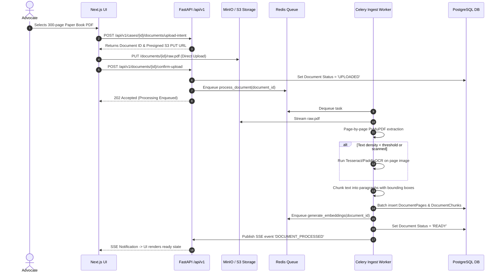
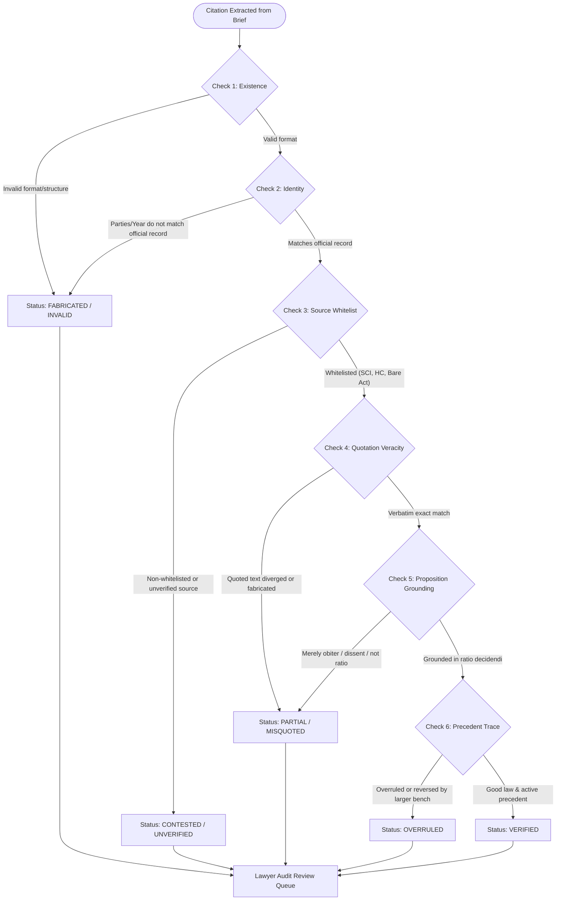
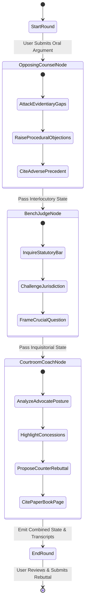

# NyaySahayak 2.0 — System Architecture Specification

**Document Reference**: `docs/ARCHITECTURE.md`  
**Status**: Approved Architecture  
**Architecture Pattern**: Layered Modular Monolith with Asynchronous Distributed Worker  
**Author**: Lead Software Architect & Senior Full-Stack Engineer  
**Date**: October 2026  

---

## 1. Architectural Philosophy & Principles

NyaySahayak 2.0 is designed around four non-negotiable architectural mandates:

1. **Modular Monolith over Microservices**:
   Microservices introduce distributed failure modes, network latency, transactional complexity, and operational overhead that are wholly unjustified for this system. NyaySahayak 2.0 implements a unified, strictly modular application backend with decoupled domain modules sharing a transactional PostgreSQL core and asynchronous task queue.
2. **Strict Separation of Synchronous & Asynchronous I/O**:
   The HTTP API gateway must never block on CPU-intensive or long-running I/O operations (PDF parsing, OCR, vector embeddings, multi-agent LLM loops). All heavy operations are delegated to a dedicated worker pool managed via **Redis** and **Celery**.
3. **Absolute Page-Level Provenance & Grounding**:
   Language models are never treated as primary sources of legal fact or law. Every node in the Master Case Graph and every legal claim must be anchored to an immutable physical coordinate (Document ID, Page Number, Paragraph, Bounding Box) or an authoritative statute/judgment hash.
4. **"Editorial Forensic" Cohesion**:
   The frontend is an evidentiary instrument, not an entertainment dashboard. It couples server-side rendering (Next.js App Router) for structural speed and deep linkability with high-performance client-side interactivity (React 19, Framer Motion, React Three Fiber 9) for complex forensic timelines and courtroom sparring arenas.

---

## 2. High-Level System Architecture Diagram

```mermaid
flowchart TB
    subgraph Client ["Frontend: Next.js App Router (React 19 + TypeScript)"]
        UI_App["Next.js Server & Client Components"]
        UI_State["Client State & TanStack Query"]
        UI_3D["React Three Fiber 9 & Drei Canvas"]
        UI_Styles["Tailwind CSS + shadcn/ui (Editorial Forensic)"]
    end

    subgraph Gateway ["API Layer: FastAPI (Python 3.12) /api/v1"]
        API_Auth["Auth & Workspace RBAC Router"]
        API_Cases["Case Docket & Workspace Router"]
        API_Docs["Document Ingestion Router"]
        API_Graph["Case Graph & Evidence Router"]
        API_Verify["6-Check Verification Router"]
        API_Sim["Courtroom Arena Router"]
        API_Research["Legal Research & Q&A Router"]
    end

    subgraph Worker ["Asynchronous Worker Pool (Celery + Redis)"]
        Queue["Redis Task Queue & PubSub"]
        Worker_Ingest["Document Ingestion & OCR Task"]
        Worker_Embed["pgvector Embedding Generator"]
        Worker_Graph["LLM Case Graph Synthesizer"]
        Worker_Sim["LangGraph Courtroom Simulation Runner"]
    end

    subgraph Storage ["Persistent Data & Object Storage"]
        DB[(PostgreSQL 16\nRelational + pgvector + FTS)]
        S3[(MinIO / S3 Object Storage\nEncrypted Document Vault)]
        Alembic["Alembic Schema Migrations"]
    end

    subgraph AI_Engine ["Provider-Agnostic Legal Intelligence Engine"]
        LLM_Adapter["Model Adapter Layer (Gemini 2.0 / GPT-4o / Ollama)"]
        Schema_Guard["Pydantic Output Validation & Guardrails"]
        LangGraph_Engine["LangGraph State Machine (Courtroom Arena)"]
    end

    Client -->|HTTP REST / SSE Stream| Gateway
    Gateway -->|Read / Write Metadata| DB
    Gateway -->|Enqueue Async Tasks| Queue
    Gateway -->|Presigned URLs| S3
    Client -->|Direct File Upload via Presigned URL| S3

    Queue --> Worker_Ingest
    Queue --> Worker_Embed
    Queue --> Worker_Graph
    Queue --> Worker_Sim

    Worker_Ingest -->|Read Raw PDF/DOCX| S3
    Worker_Ingest -->|Store Chunks & Provenance| DB
    Worker_Embed -->|Store Vectors (1536d / 768d)| DB
    Worker_Graph -->|Invoke Structured Prompts| LLM_Adapter
    Worker_Graph -->|Store Graph Nodes & Edges| DB
    Worker_Sim -->|Step Multi-Agent Graph| LangGraph_Engine
    Worker_Sim -->|Stream Turns via Redis PubSub| Gateway
```

---

## 3. Subsystem Breakdown & Component Architecture

### 3.1 Frontend Architecture (Next.js 15+ App Router)
- **Directory Structure**:
  ```text
  frontend/
  ├── src/
  │   ├── app/                    # Next.js App Router pages & API routes
  │   │   ├── (auth)/             # Login, register, workspace onboarding
  │   │   ├── (dashboard)/        # Workspace switcher, case docket, settings
  │   │   ├── cases/[caseId]/     # Case-specific sub-routes:
  │   │   │   ├── overview/       # Master summary & health cards
  │   │   │   ├── documents/      # Page-preserved PDF viewer & chunk inspector
  │   │   │   ├── graph/          # Interactive 2D/3D case graph & timeline
  │   │   │   ├── verification/   # 6-Check citation testing laboratory
  │   │   │   ├── research/       # Grounded Q&A against case & Bare Acts
  │   │   │   └── courtroom/      # LangGraph adversarial sparring arena
  │   ├── components/
  │   │   ├── ui/                 # shadcn/ui base primitives (buttons, dialogs, tabs)
  │   │   ├── editorial/          # Custom Editorial Forensic UI components
  │   │   ├── viewer/             # Split-screen PDF viewer with bounding-box canvas
  │   │   ├── three/              # R3F canvas components (3D timeline, bench arena)
  │   ├── lib/                    # API client, TanStack Query providers, Zod schemas
  │   └── styles/                 # Global CSS, Tailwind tokens, font declarations
  ```
- **State Management & Data Fetching**:
  - Server Components for fast initial page load and SEO/metadata rendering.
  - TanStack Query (React Query) for client-side server state synchronization, optimistic updates, and polling.
  - Server-Sent Events (SSE) listener for live document processing updates and courtroom sparring streams.

### 3.2 Backend Modular Monolith Architecture (FastAPI)
- **Directory Structure**:
  ```text
  backend/
  ├── app/
  │   ├── api/
  │   │   ├── v1/
  │   │   │   ├── auth.py
  │   │   │   ├── workspaces.py
  │   │   │   ├── cases.py
  │   │   │   ├── documents.py
  │   │   │   ├── case_graph.py
  │   │   │   ├── verification.py
  │   │   │   ├── research.py
  │   │   │   └── courtroom.py
  │   ├── core/
  │   │   ├── config.py           # Pydantic BaseSettings (env management)
  │   │   ├── security.py         # JWT tokens, Argon2 password hashing, RBAC
  │   │   └── exceptions.py       # Custom RFC 7807 problem exceptions
  │   ├── db/
  │   │   ├── base.py             # SQLAlchemy DeclarativeBase
  │   │   ├── session.py          # Async & Sync engine session factories
  │   │   └── models/             # Modular SQLAlchemy models:
  │   │       ├── workspace.py
  │   │       ├── user.py
  │   │       ├── case.py
  │   │       ├── document.py
  │   │       ├── case_graph.py
  │   │       ├── authority.py
  │   │       ├── verification.py
  │   │       └── courtroom.py
  │   ├── schemas/                # Pydantic v2 validation contracts
  │   ├── services/               # Pure domain business logic:
  │   │   ├── document_service.py
  │   │   ├── provenance_service.py
  │   │   ├── graph_service.py
  │   │   ├── verification_service.py
  │   │   └── search_service.py
  │   ├── ai/                     # AI integrations & LangGraph workflows:
  │   │   ├── client.py           # Provider-independent LLM router
  │   │   ├── prompts/            # Version-controlled prompt templates
  │   │   ├── agents/             # LangGraph courtroom simulation actors:
  │   │   │   ├── state.py
  │   │   │   ├── opposing_counsel.py
  │   │   │   ├── bench_judge.py
  │   │   │   └── coach_agent.py
  │   │   └── graph.py            # Compiled LangGraph state machine
  │   ├── workers/                # Celery task definitions:
  │   │   ├── celery_app.py
  │   │   ├── document_tasks.py
  │   │   └── graph_tasks.py
  │   └── storage/                # MinIO / S3 client wrapper with presigned URLs
  ├── alembic/                    # Database migration scripts
  └── tests/                      # pytest test suite
  ```

---

## 4. Document Ingestion & Page-Level Provenance Engine

### 4.1 Ingestion Pipeline


### 4.2 Provenance Coordinate Standard
Every extracted piece of legal data (party name, date, allegation, exhibit) must record an immutable `ProvenanceObject`:
```json
{
  "document_id": "9b1deb4d-3b7d-4bad-9bdd-2b0d7b3dcb6d",
  "document_name": "Special_Leave_Petition_Paper_Book_Vol_1.pdf",
  "page_number": 142,
  "paragraph_number": 4,
  "character_start": 320,
  "character_end": 512,
  "bounding_box": {
    "x0": 72.0,
    "y0": 210.5,
    "x1": 520.0,
    "y1": 275.2
  },
  "extraction_confidence": 0.98,
  "ocr_applied": false,
  "language": "en"
}
```

---

## 5. The 6-Check Citation Verification Protocol Architecture

Citation verification is not an arbitrary LLM prompt; it is an algorithmic 6-stage quality gate:



---

## 6. Authoritative Legal Corpus Registry & Ingestion

### 6.1 Whitelisted Sources
Authoritative legal records are partitioned strictly into an immutable `authorities_corpus` repository:
1. **Supreme Court Reports (SCR) & Official e-SCR**: Judgments of the Supreme Court of India.
2. **High Court Official Judgments**: Digital registries of Delhi, Bombay, Madras, and Calcutta High Courts.
3. **India Code (Bare Acts)**: Central and state legislative statutes, with explicit amendment versioning (e.g., Indian Penal Code 1860 vs. Bharatiya Nyaya Sanhita 2023; Indian Evidence Act 1872 vs. Bharatiya Sakshya Adhiniyam 2023).
4. **Official Gazette of India (e-Gazette)**: Notification dates for statutory enforceability.

### 6.2 Authority Verification Rule
**Critical Mandate**: No legal authority is classified as `VERIFIED` merely because an external URL, database row, or Wikipedia entry exists. An authority is only verified if:
- It matches a cryptographic content hash of the official registry publication.
- Its judicial status has been checked against subsequent negative treatment (overruled, distinguished, doubted, or referred).
- Synthetic test fixtures and mock judgments are stored in a dedicated `synthetic_authorities` schema with strict runtime isolation tags.

---

## 7. Multi-Agent Courtroom Arena (LangGraph Orchestration)

The Courtroom Arena implements an adversarial legal simulation where an advocate spars with opposing counsel and the bench before a hearing.



### 7.1 Agent Roles & Cognitive Contracts
- **Opposing Counsel (Red Teamer)**:
  - System Persona: Aggressive, legally astute senior litigator representing the Respondent.
  - Objectives: Find missing annexures, assert lack of territorial/pecuniary jurisdiction, claim alternative statutory remedies exist, highlight delays and laches.
- **Bench Judge (The Inquisitor)**:
  - System Persona: Experienced High Court or Supreme Court Judge.
  - Objectives: Guard judicial economy, enforce statutory bars (e.g., Section 14 IBC moratorium, Section 34 A&C Act scope), interrupt rambling arguments, demand specific page references in the paper book.
- **Courtroom Coach (Strategic Ally)**:
  - System Persona: Retired Chief Justice / Senior Strategist mentoring the user.
  - Objectives: Point out rhetorical traps set by opposing counsel, identify unanswered bench questions, suggest exact statutory provisions and pages from the record to quote immediately.

---

## 8. Technology Stack Specification

| Tier | Component | Technology & Version | Purpose |
| :--- | :--- | :--- | :--- |
| **Frontend** | Framework | Next.js 15+ (App Router) | Server-side rendering, routing, static optimization |
| | UI Library | React 19, TypeScript 5.5+ | Modern typed component architecture |
| | Styling & UI | Tailwind CSS 3.4+, shadcn/ui | "Editorial Forensic" custom design system |
| | Motion | Framer Motion | Fluid state transitions, drawer animations |
| | 3D Graphics | Three.js, React Three Fiber 9, Drei | Forensic timeline stack & courtroom spatial simulator |
| | Validation | Zod | Client-side form & input contract validation |
| **Backend** | API Gateway | Python 3.12, FastAPI 0.115+ | High-performance async modular REST API |
| | Schemas | Pydantic v2 | Data validation, serialisation, and LLM output guardrails |
| | ORM | SQLAlchemy 2.0 (Async/Sync) | Relational persistence & query builder |
| | Migrations | Alembic | Tracked, reproducible schema evolution |
| **Workers** | Task Queue | Celery 5.4+, Redis 7.2+ | Distributed background task execution |
| **Database** | RDBMS & Vector | PostgreSQL 16 + pgvector + FTS | Relational data, semantic embeddings, full-text search |
| **Storage** | Object Store | MinIO (local) / AWS S3 (prod) | Encrypted, presigned-URL document storage |
| **AI / Orchestration** | Multi-Agent | LangGraph, LangChain Core | State-machine multi-agent courtroom execution |
| | LLMs | Provider-agnostic (Gemini 2.0, GPT-4o) | High-fidelity legal analysis and extraction |
| **Tooling & Ops** | Lint & Format | Ruff (Python), ESLint + Prettier (TS) | Code quality, zero-warning compliance |
| | Testing | pytest, Playwright | Unit, integration, and E2E browser test automation |
| | Infra | Docker Compose | Local development containerization |
