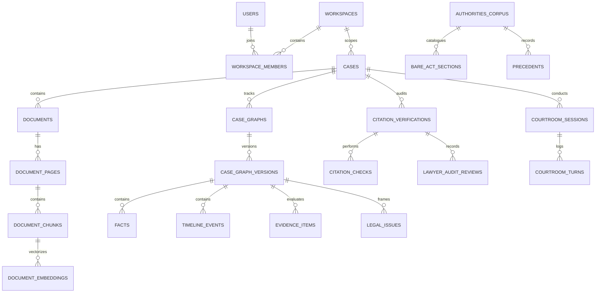
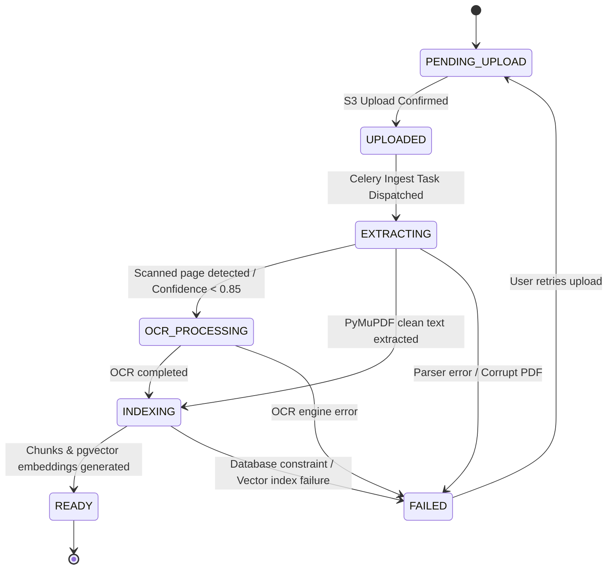
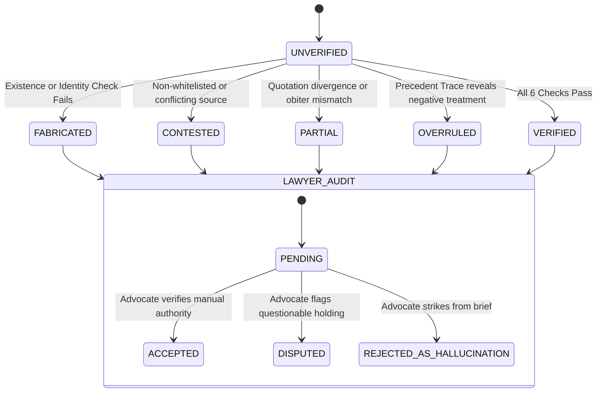

# NyaySahayak 2.0 — Relational Data Model & State Machine Specification

**Document Reference**: `docs/DATA_MODEL.md`  
**Status**: Approved Data Specification  
**Database**: PostgreSQL 16 with `pgvector` and `pg_trgm` (Full-Text Search)  
**ORM**: SQLAlchemy 2.0 (Declarative Base with Mapped Types)  
**Migrations**: Alembic  
**Author**: Lead Software Architect & Database Engineer  

---

## 1. Entity-Relationship Overview & Multi-Tenant Boundaries

In NyaySahayak 2.0, **every legal record belongs to a Workspace**. Users access cases through explicit Workspace memberships and role assignments.



---

## 2. Table Schemas & Column Definitions

### 2.1 Workspace & Identity Layer

#### `users`
Represents an individual advocate, clerk, or system user.
```sql
CREATE TABLE users (
    id UUID PRIMARY KEY DEFAULT gen_random_uuid(),
    email VARCHAR(255) UNIQUE NOT NULL,
    hashed_password VARCHAR(255) NOT NULL,
    full_name VARCHAR(255) NOT NULL,
    bar_council_id VARCHAR(100),
    phone_number VARCHAR(50),
    is_active BOOLEAN NOT NULL DEFAULT TRUE,
    is_superuser BOOLEAN NOT NULL DEFAULT FALSE,
    created_at TIMESTAMPTZ NOT NULL DEFAULT clock_timestamp(),
    updated_at TIMESTAMPTZ NOT NULL DEFAULT clock_timestamp()
);
CREATE INDEX idx_users_email ON users(email);
```

#### `workspaces`
The primary multi-tenant isolation unit (Chamber, Law Firm, or Legal Department).
```sql
CREATE TABLE workspaces (
    id UUID PRIMARY KEY DEFAULT gen_random_uuid(),
    name VARCHAR(255) NOT NULL,
    slug VARCHAR(100) UNIQUE NOT NULL,
    subscription_tier VARCHAR(50) NOT NULL DEFAULT 'CHAMBER_STANDARD',
    storage_quota_bytes BIGINT NOT NULL DEFAULT 53687091200, -- 50 GB default
    created_at TIMESTAMPTZ NOT NULL DEFAULT clock_timestamp(),
    updated_at TIMESTAMPTZ NOT NULL DEFAULT clock_timestamp()
);
CREATE INDEX idx_workspaces_slug ON workspaces(slug);
```

#### `workspace_members`
Mapping between Users and Workspaces with explicit Role-Based Access Control.
```sql
CREATE TYPE workspace_role AS ENUM (
    'OWNER',            -- Managing Partner / Senior Advocate
    'SENIOR_ADVOCATE',   -- Arguing Counsel (full case access, courtroom sparring)
    'ASSOCIATE',        -- Briefing Counsel (document upload, case editing)
    'PARALEGAL',        -- Clerk / Researcher (read-only and OCR verification)
    'AUDITOR'           -- External compliance or client observer (read-only)
);

CREATE TABLE workspace_members (
    id UUID PRIMARY KEY DEFAULT gen_random_uuid(),
    workspace_id UUID NOT NULL REFERENCES workspaces(id) ON DELETE CASCADE,
    user_id UUID NOT NULL REFERENCES users(id) ON DELETE CASCADE,
    role workspace_role NOT NULL DEFAULT 'ASSOCIATE',
    created_at TIMESTAMPTZ NOT NULL DEFAULT clock_timestamp(),
    CONSTRAINT uq_workspace_user UNIQUE (workspace_id, user_id)
);
CREATE INDEX idx_workspace_members_user ON workspace_members(user_id);
```

---

### 2.2 Case Docket Layer

#### `cases`
The central litigation matter.
```sql
CREATE TYPE court_type AS ENUM (
    'SUPREME_COURT_OF_INDIA',
    'HIGH_COURT',
    'DISTRICT_COURT',
    'NCLT_NCLAT',
    'DRT_DRAT',
    'ARBITRATION_TRIBUNAL',
    'OTHER_TRIBUNAL'
);

CREATE TYPE case_status AS ENUM (
    'ACTIVE',
    'RESERVED_FOR_JUDGMENT',
    'DISPOSED',
    'ARCHIVED'
);

CREATE TABLE cases (
    id UUID PRIMARY KEY DEFAULT gen_random_uuid(),
    workspace_id UUID NOT NULL REFERENCES workspaces(id) ON DELETE CASCADE,
    title VARCHAR(500) NOT NULL,
    case_number VARCHAR(100),               -- e.g. "SLP (C) No. 12345 of 2024"
    cnr_number VARCHAR(30),                 -- Case Natural Record number in e-Courts
    court_type court_type NOT NULL,
    court_bench VARCHAR(255),               -- e.g. "Principal Bench, New Delhi"
    matter_type VARCHAR(100) NOT NULL,      -- "Civil", "Criminal", "Writ", "Commercial"
    side_represented VARCHAR(50) NOT NULL,  -- "PETITIONER" or "RESPONDENT"
    lead_counsel VARCHAR(255),
    description TEXT,
    status case_status NOT NULL DEFAULT 'ACTIVE',
    created_at TIMESTAMPTZ NOT NULL DEFAULT clock_timestamp(),
    updated_at TIMESTAMPTZ NOT NULL DEFAULT clock_timestamp()
);
CREATE INDEX idx_cases_workspace ON cases(workspace_id);
CREATE INDEX idx_cases_case_number ON cases(case_number);
```

---

### 2.3 Documents, Pages & Provenance Layer

#### `documents`
Uploaded paper books, petitions, rejoinders, and evidence files.
```sql
CREATE TYPE document_status AS ENUM (
    'PENDING_UPLOAD',
    'UPLOADED',
    'EXTRACTING',
    'OCR_PROCESSING',
    'INDEXING',
    'READY',
    'FAILED'
);

CREATE TABLE documents (
    id UUID PRIMARY KEY DEFAULT gen_random_uuid(),
    workspace_id UUID NOT NULL REFERENCES workspaces(id) ON DELETE CASCADE,
    case_id UUID NOT NULL REFERENCES cases(id) ON DELETE CASCADE,
    file_name VARCHAR(500) NOT NULL,
    s3_key VARCHAR(1024) NOT NULL,
    mime_type VARCHAR(100) NOT NULL,
    file_size_bytes BIGINT NOT NULL,
    sha256_hash VARCHAR(64) NOT NULL,
    page_count INT NOT NULL DEFAULT 0,
    status document_status NOT NULL DEFAULT 'PENDING_UPLOAD',
    error_message TEXT,
    ocr_applied BOOLEAN NOT NULL DEFAULT FALSE,
    detected_languages TEXT[] DEFAULT ARRAY['en'],
    created_at TIMESTAMPTZ NOT NULL DEFAULT clock_timestamp(),
    updated_at TIMESTAMPTZ NOT NULL DEFAULT clock_timestamp()
);
CREATE INDEX idx_documents_case ON documents(case_id);
CREATE INDEX idx_documents_hash ON documents(sha256_hash);
```

#### `document_pages`
Represents an individual page within a document, preserving physical geometry.
```sql
CREATE TABLE document_pages (
    id UUID PRIMARY KEY DEFAULT gen_random_uuid(),
    document_id UUID NOT NULL REFERENCES documents(id) ON DELETE CASCADE,
    page_number INT NOT NULL,               -- 1-indexed
    width_pts FLOAT NOT NULL,
    height_pts FLOAT NOT NULL,
    text_content TEXT,
    is_scanned BOOLEAN NOT NULL DEFAULT FALSE,
    ocr_confidence FLOAT,                   -- 0.0 to 1.0
    image_s3_key VARCHAR(1024),             -- Rendered page preview image
    created_at TIMESTAMPTZ NOT NULL DEFAULT clock_timestamp(),
    CONSTRAINT uq_doc_page UNIQUE (document_id, page_number)
);
CREATE INDEX idx_doc_pages_doc_num ON document_pages(document_id, page_number);
```

#### `document_chunks`
Granular paragraphs and propositions extracted from pages with precise coordinates.
```sql
CREATE TABLE document_chunks (
    id UUID PRIMARY KEY DEFAULT gen_random_uuid(),
    document_id UUID NOT NULL REFERENCES documents(id) ON DELETE CASCADE,
    page_number INT NOT NULL,
    chunk_index INT NOT NULL,
    text_content TEXT NOT NULL,
    char_start INT NOT NULL,
    char_end INT NOT NULL,
    bounding_box JSONB NOT NULL,            -- {x0, y0, x1, y1}
    language VARCHAR(10) NOT NULL DEFAULT 'en',
    script_type VARCHAR(30) NOT NULL DEFAULT 'latin',
    created_at TIMESTAMPTZ NOT NULL DEFAULT clock_timestamp()
);
CREATE INDEX idx_chunks_doc_page ON document_chunks(document_id, page_number);
```

#### `document_embeddings`
Vector store embeddings for semantic hybrid retrieval.
```sql
CREATE EXTENSION IF NOT EXISTS vector;

CREATE TABLE document_embeddings (
    id UUID PRIMARY KEY DEFAULT gen_random_uuid(),
    chunk_id UUID NOT NULL REFERENCES document_chunks(id) ON DELETE CASCADE,
    embedding vector(1536),                 -- 1536d (e.g. text-embedding-3-large / Gemini 768d adaptable)
    created_at TIMESTAMPTZ NOT NULL DEFAULT clock_timestamp()
);
CREATE INDEX idx_doc_embeddings_cosine ON document_embeddings USING ivfflat (embedding vector_cosine_ops) WITH (lists = 100);
```

---

### 2.4 Case Graph & Structured Legal Intelligence Layer

#### `case_graphs` & `case_graph_versions`
Versioned container of the master intelligence synthesized from case documents.
```sql
CREATE TABLE case_graphs (
    id UUID PRIMARY KEY DEFAULT gen_random_uuid(),
    case_id UUID NOT NULL REFERENCES cases(id) ON DELETE CASCADE,
    current_version VARCHAR(20) NOT NULL DEFAULT '1.0.0',
    created_at TIMESTAMPTZ NOT NULL DEFAULT clock_timestamp()
);

CREATE TABLE case_graph_versions (
    id UUID PRIMARY KEY DEFAULT gen_random_uuid(),
    case_graph_id UUID NOT NULL REFERENCES case_graphs(id) ON DELETE CASCADE,
    version_tag VARCHAR(20) NOT NULL,       -- e.g. "1.0.0", "1.1.0"
    summary TEXT NOT NULL,
    synthesis_metadata JSONB NOT NULL,      -- Model used, prompt tokens, execution time
    is_published BOOLEAN NOT NULL DEFAULT TRUE,
    created_at TIMESTAMPTZ NOT NULL DEFAULT clock_timestamp(),
    CONSTRAINT uq_graph_version UNIQUE (case_graph_id, version_tag)
);
```

#### `facts`
Discreet factual claims extracted with page-level provenance.
```sql
CREATE TYPE fact_status AS ENUM (
    'ADMITTED',
    'DISPUTED',
    'UNVERIFIED',
    'PROVEN_BY_RECORD'
);

CREATE TABLE facts (
    id UUID PRIMARY KEY DEFAULT gen_random_uuid(),
    graph_version_id UUID NOT NULL REFERENCES case_graph_versions(id) ON DELETE CASCADE,
    title VARCHAR(300) NOT NULL,
    statement TEXT NOT NULL,
    status fact_status NOT NULL DEFAULT 'UNVERIFIED',
    provenance_doc_id UUID REFERENCES documents(id),
    provenance_page INT,
    provenance_bbox JSONB,
    created_at TIMESTAMPTZ NOT NULL DEFAULT clock_timestamp()
);
```

#### `timeline_events`
Chronological milestones extracted from pleadings, FIRs, and orders.
```sql
CREATE TABLE timeline_events (
    id UUID PRIMARY KEY DEFAULT gen_random_uuid(),
    graph_version_id UUID NOT NULL REFERENCES case_graph_versions(id) ON DELETE CASCADE,
    event_date DATE NOT NULL,
    event_time TIME,
    title VARCHAR(300) NOT NULL,
    description TEXT NOT NULL,
    is_disputed BOOLEAN NOT NULL DEFAULT FALSE,
    contradiction_notes TEXT,
    provenance_doc_id UUID REFERENCES documents(id),
    provenance_page INT,
    created_at TIMESTAMPTZ NOT NULL DEFAULT clock_timestamp()
);
CREATE INDEX idx_timeline_events_date ON timeline_events(event_date);
```

#### `evidence_items`
Exhibits, annexures, and oral testimonies evaluated for admissibility and weight.
```sql
CREATE TYPE evidence_type AS ENUM (
    'PRIMARY_DOCUMENTARY',
    'SECONDARY_DOCUMENTARY',
    'ELECTRONIC_RECORD',
    'ORAL_DEPOSITION',
    'EXPERT_OPINION',
    'REAL_OBJECT'
);

CREATE TABLE evidence_items (
    id UUID PRIMARY KEY DEFAULT gen_random_uuid(),
    graph_version_id UUID NOT NULL REFERENCES case_graph_versions(id) ON DELETE CASCADE,
    exhibit_mark VARCHAR(50) NOT NULL,     -- e.g. "Ex. P-1", "Annexure A-4"
    title VARCHAR(300) NOT NULL,
    evidence_type evidence_type NOT NULL,
    admissibility_status VARCHAR(50) NOT NULL, -- "ADMISSIBLE", "CONTESTED", "DEFECTIVE_65B"
    compliance_notes TEXT,                 -- e.g. "Section 65B Certificate missing"
    provenance_doc_id UUID REFERENCES documents(id),
    provenance_page INT,
    created_at TIMESTAMPTZ NOT NULL DEFAULT clock_timestamp()
);
```

#### `legal_issues`
Framed legal questions and statutory propositions.
```sql
CREATE TABLE legal_issues (
    id UUID PRIMARY KEY DEFAULT gen_random_uuid(),
    graph_version_id UUID NOT NULL REFERENCES case_graph_versions(id) ON DELETE CASCADE,
    issue_number INT NOT NULL,
    framing TEXT NOT NULL,
    governing_statutes TEXT[] NOT NULL,     -- e.g. ARRAY['Article 226', 'Section 9 CPC']
    petitioner_contention TEXT,
    respondent_contention TEXT,
    created_at TIMESTAMPTZ NOT NULL DEFAULT clock_timestamp()
);
```

---

### 2.5 Authoritative Legal Corpus & Citation Verification Layer

#### `authorities_corpus`
Official statutory registries and judgment gazettes.
```sql
CREATE TABLE authorities_corpus (
    id UUID PRIMARY KEY DEFAULT gen_random_uuid(),
    jurisdiction VARCHAR(50) NOT NULL,     -- "INDIA_CENTRAL", "DELHI", "MAHARASHTRA"
    title VARCHAR(500) NOT NULL,
    act_number_year VARCHAR(50),           -- "Act 45 of 1860"
    official_source_url VARCHAR(1024),
    content_hash VARCHAR(64) NOT NULL,
    is_whitelisted BOOLEAN NOT NULL DEFAULT TRUE,
    created_at TIMESTAMPTZ NOT NULL DEFAULT clock_timestamp()
);
```

#### `citation_verifications`
The 6-Check verification audit record.
```sql
CREATE TYPE verification_badge AS ENUM (
    'VERIFIED',
    'PARTIAL',
    'CONTESTED',
    'OVERRULED',
    'FABRICATED'
);

CREATE TYPE lawyer_review_decision AS ENUM (
    'PENDING',
    'ACCEPTED',
    'DISPUTED',
    'REJECTED_AS_HALLUCINATION'
);

CREATE TABLE citation_verifications (
    id UUID PRIMARY KEY DEFAULT gen_random_uuid(),
    case_id UUID NOT NULL REFERENCES cases(id) ON DELETE CASCADE,
    citation_text TEXT NOT NULL,
    extracted_from_doc_id UUID REFERENCES documents(id),
    extracted_from_page INT,
    overall_status verification_badge NOT NULL DEFAULT 'UNVERIFIED',
    existence_pass BOOLEAN NOT NULL DEFAULT FALSE,
    identity_pass BOOLEAN NOT NULL DEFAULT FALSE,
    whitelist_pass BOOLEAN NOT NULL DEFAULT FALSE,
    quotation_pass BOOLEAN NOT NULL DEFAULT FALSE,
    proposition_pass BOOLEAN NOT NULL DEFAULT FALSE,
    trace_pass BOOLEAN NOT NULL DEFAULT FALSE,
    check_details JSONB NOT NULL,
    lawyer_review lawyer_review_decision NOT NULL DEFAULT 'PENDING',
    lawyer_notes TEXT,
    created_at TIMESTAMPTZ NOT NULL DEFAULT clock_timestamp(),
    updated_at TIMESTAMPTZ NOT NULL DEFAULT clock_timestamp()
);
CREATE INDEX idx_citations_case ON citation_verifications(case_id);
```

---

### 2.6 Courtroom Arena Simulation Layer

#### `courtroom_sessions` & `courtroom_turns`
Stores the multi-agent sparring history and strategic coaching critiques.
```sql
CREATE TYPE courtroom_status AS ENUM (
    'INITIALIZED',
    'ACTIVE_SPARRING',
    'ADJOURNED',
    'CONCLUDED'
);

CREATE TABLE courtroom_sessions (
    id UUID PRIMARY KEY DEFAULT gen_random_uuid(),
    case_id UUID NOT NULL REFERENCES cases(id) ON DELETE CASCADE,
    active_issue_id UUID REFERENCES legal_issues(id),
    bench_composition VARCHAR(100) NOT NULL DEFAULT 'Division Bench (2 Judges)',
    status courtroom_status NOT NULL DEFAULT 'INITIALIZED',
    created_at TIMESTAMPTZ NOT NULL DEFAULT clock_timestamp(),
    updated_at TIMESTAMPTZ NOT NULL DEFAULT clock_timestamp()
);

CREATE TYPE speaker_role AS ENUM (
    'ADVOCATE',
    'OPPOSING_COUNSEL',
    'BENCH_JUDGE',
    'COURTROOM_COACH'
);

CREATE TABLE courtroom_turns (
    id UUID PRIMARY KEY DEFAULT gen_random_uuid(),
    session_id UUID NOT NULL REFERENCES courtroom_sessions(id) ON DELETE CASCADE,
    turn_number INT NOT NULL,
    speaker_role speaker_role NOT NULL,
    speaker_name VARCHAR(100) NOT NULL,
    content TEXT NOT NULL,
    objections JSONB,                      -- Procedural objections raised by Opposing Counsel
    bench_tendency VARCHAR(100),           -- Inquisitorial demeanor: "SKEPTICAL", "INTERRUPTING", "NEUTRAL"
    coach_gap_analysis JSONB,              -- Missed points, recommended citations
    created_at TIMESTAMPTZ NOT NULL DEFAULT clock_timestamp()
);
CREATE INDEX idx_courtroom_turns_session ON courtroom_turns(session_id, turn_number);
```

---

## 3. Processing State Machines & Lifecycles

### 3.1 Document Ingestion State Machine


### 3.2 Citation Verification State Machine


---

## 4. Ownership Boundaries & Row-Level Security (RLS)

1. **Server-Enforced Scoping**:
   Every database query executed through the application repository layer must explicitly include `WHERE workspace_id = :active_workspace_id`.
2. **PostgreSQL Row-Level Security (RLS)**:
   In production, RLS policies will be enabled on all tenant-scoped tables:
   ```sql
   ALTER TABLE cases ENABLE ROW LEVEL SECURITY;
   CREATE POLICY case_workspace_isolation_policy ON cases
       FOR ALL
       USING (workspace_id = current_setting('app.current_workspace_id')::UUID);
   ```
3. **No Direct User ID Trust**:
   The API will never accept a `user_id` or `workspace_id` in request body parameters to infer authorization. The active workspace and user are resolved strictly from the verified JWT access token and session context.
