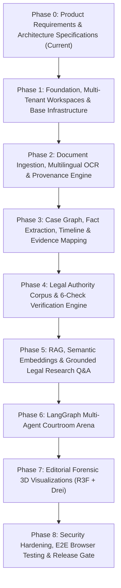

# NyaySahayak 2.0 — Implementation Phase Plan & Milestone Roadmap

**Document Reference**: `docs/PHASE_PLAN.md`  
**Status**: Approved Master Phase Roadmap  
**Execution Standard**: GSD (Git. Ship. Done.) Spec-Driven Phase Discipline  
**Author**: Lead Software Architect & Senior Full-Stack Engineer  
**Date**: October 2026  

---

## 1. Phase Overview & Dependency Graph

NyaySahayak 2.0 is partitioned into nine strictly sequenced implementation phases. No phase may commence until all completion criteria and automated verification tests of the preceding phase have passed.

---

## 2. Granular Phase Specifications

### Phase 0: Product Requirements & Architecture Specifications
- **Objective**: Establish the complete foundational specifications, PRD, architecture, data schemas, API contracts, design system, and verification strategies before writing application code.
- **Deliverables**:
  - `docs/LEGACY_AUDIT.md`
  - `docs/PRODUCT_REQUIREMENTS.md`
  - `docs/ARCHITECTURE.md`
  - `docs/DATA_MODEL.md`
  - `docs/API_CONTRACTS.md`
  - `docs/DESIGN_SYSTEM.md`
  - `docs/SECURITY.md`
  - `docs/TEST_STRATEGY.md`
  - `docs/PHASE_PLAN.md`
  - `docs/IMPLEMENTATION_STATUS.md`
- **Dependencies**: None.
- **Completion Criteria**: All 10 documents exist, are internally consistent, and strictly adhere to the Master Prompt. No application code written.

---

### Phase 1: Foundation, Multi-Tenant Workspaces & Base Infrastructure
- **Objective**: Stand up the local infrastructure, database schemas with Alembic migrations, secure authentication, multi-tenant workspace isolation, and Next.js / FastAPI scaffolding.
- **Deliverables**:
  - `docker-compose.yml` configured for PostgreSQL 16 (`pgvector/pgvector:pg16`), Redis 7, and MinIO.
  - Backend modular monolith skeleton: FastAPI app with versioned `/api/v1` routers, Pydantic settings, and SQLAlchemy 2.0 engine.
  - Initial Alembic migration creating `users`, `workspaces`, `workspace_members`, and `cases` tables.
  - Authentication service: Registration, login, JWT token rotation, password hashing (Argon2id/bcrypt), and workspace resolution middleware.
  - Frontend scaffolding: Next.js 15+ App Router, TypeScript, Tailwind CSS, shadcn/ui initial components, and global "Editorial Forensic" tokens (`paper`, `ink`, `vermilion`).
  - Automated tests: Unit and API integration tests for auth and workspace isolation (`pytest`).
- **Dependencies**: Phase 0.
- **Completion Criteria**: Docker containers run cleanly; Alembic migrations upgrade and downgrade; user registration, login, and workspace creation endpoints return valid responses and pass pytest.

---

### Phase 2: Document Ingestion, Multilingual OCR & Provenance Engine
- **Objective**: Build the asynchronous document processing pipeline capable of handling large multi-volume paper books with physical page-coordinate retention.
- **Deliverables**:
  - MinIO S3 integration: Presigned URL generator for secure direct file uploads.
  - Celery background worker setup with Redis broker.
  - Document parsing service (`PyMuPDF`) with page-by-page text and bounding-box coordinate extraction.
  - Multilingual OCR processor (Tesseract/PaddleOCR) with automatic scan-density detection for Hindi (Devanagari), Tamil, and degraded English pages.
  - Database persistence: `documents`, `document_pages`, and `document_chunks` models and Alembic migration.
  - Split-screen Document Viewer UI: Render original PDF on left with synchronized bounding-box highlight overlays on right.
  - Automated tests: Parsing fixtures for typed PDFs, scanned pages, and vernacular briefs.
- **Dependencies**: Phase 1.
- **Completion Criteria**: A 100-page paper book PDF uploads via presigned URL, processes asynchronously via Celery in < 90 seconds, and renders in the split-screen viewer with exact bounding-box coordinates.

---

### Phase 3: Case Graph, Fact Extraction, Timeline & Evidence Mapping
- **Objective**: Implement the structured extraction pipeline that transforms raw document chunks into a versioned Master Case Graph.
- **Deliverables**:
  - Provider-agnostic LLM adapter with strict Pydantic v2 output schemas.
  - Fact extraction service: Extracts parties, admitted facts, disputed claims, and legal issues.
  - Timeline engine: Extracts chronological events, flags date contradictions, and cross-references postal/FIR receipts.
  - Evidence mapper: Classifies exhibits (Ex. P-1, Annexures) and audits Section 65B compliance for digital records.
  - Master Case Graph database models (`case_graphs`, `case_graph_versions`, `facts`, `timeline_events`, `evidence_items`, `legal_issues`) and Alembic migration.
  - Frontend Dossier Dashboard: Interactive cards for Facts, Timeline, Evidence, and Issues with click-to-provenance navigation.
  - Automated tests: Deterministic evaluation of graph extraction on benchmark case filings.
- **Dependencies**: Phase 2.
- **Completion Criteria**: Master Case Graph compiles asynchronously, saves as version `1.0.0`, and displays in UI with 100% of facts linked to source document pages.

---

### Phase 4: Legal Authority Corpus & 6-Check Verification Engine
- **Objective**: Build the official legal corpus registry and the 6-Check Citation Verification Protocol to eradicate legal hallucinations.
- **Deliverables**:
  - Whitelisted legal corpus models (`authorities_corpus`, `statutes`, `precedents`) and Alembic migration.
  - Ingestion pipeline for India Code Bare Acts and Supreme Court Reports (SCR).
  - The 6-Check Verification Engine:
    1. *Existence Check* (Citation syntax and reporter validation).
    2. *Identity Check* (Parties and year matching).
    3. *Source Whitelist Check* (Official SCR/HC/India Code hash verification).
    4. *Quotation Veracity Check* (Verbatim text match against official judgment).
    5. *Proposition Grounding Check* (Ratio decidendi vs. obiter dicta classification).
    6. *Precedent Trace Check* (Overruled/reversed/distinguished status).
  - Lawyer review workflow: Manual audit status overrides (`ACCEPTED`, `DISPUTED`, `REJECTED`) with audit logging.
  - Frontend Citation Laboratory: Interactive verification badge cards, detailed check breakdowns, and PDF audit report generator.
  - Automated tests: ICV-100 benchmark suite verifying 0% false positives on fabricated citations.
- **Dependencies**: Phase 3.
- **Completion Criteria**: 100% of fabricated citations flagged in automated benchmark; all 6 checks return verifiable structured output.

---

### Phase 5: RAG, Semantic Embeddings & Grounded Legal Research Q&A
- **Objective**: Implement hybrid semantic-lexical retrieval across case records and authoritative legal corpora for source-grounded research.
- **Deliverables**:
  - PostgreSQL `pgvector` embedding generation pipeline using Celery.
  - Hybrid search service: Combines pgvector cosine similarity with PostgreSQL `tsvector` full-text search and Reciprocal Rank Fusion (RRF).
  - Case Intelligence Q&A API: Queries grounded in case paper books and Bare Acts.
  - Guardrail: Explicit "INSUFFICIENT_EVIDENCE" state when query cannot be answered from authoritative sources.
  - Frontend Research Workbench: Side-by-side query input, answers with inline source-page badges, and Bare Act section inspector.
  - Automated tests: Retrieval precision tests (MRR / Hit Rate) and hallucination resistance checks.
- **Dependencies**: Phase 4.
- **Completion Criteria**: Queries return accurate answers with clickable page badges; system never invents an unrecorded legal proposition.

---

### Phase 6: LangGraph Multi-Agent Courtroom Arena
- **Objective**: Construct the adversarial oral argument sparring simulation using LangGraph state machines.
- **Deliverables**:
  - LangGraph State Machine implementation:
    - `OpposingCounselNode`: Attacks maintainability, alternative remedies, and missing exhibits.
    - `BenchJudgeNode`: Interjects with sharp statutory and constitutional queries.
    - `CourtroomCoachNode`: Analyzes concessions, flags evidentiary gaps, and suggests counter-rebuttals.
  - Real-time streaming via Redis PubSub and Server-Sent Events (SSE).
  - Database persistence: `courtroom_sessions` and `courtroom_turns` models and Alembic migration.
  - Frontend Courtroom Arena: Multi-agent sparring dialogue interface with speaker indicators, objection tags, and coach cards.
  - Automated tests: LangGraph node execution tests, state transition tests, and adversarial prompt resilience checks.
- **Dependencies**: Phase 5.
- **Completion Criteria**: Multi-turn courtroom sparring loop runs end-to-end, stream updates via SSE, and preserves session transcripts.

---

### Phase 7: "Editorial Forensic" 3D Visualizations (React Three Fiber 9 & Drei)
- **Objective**: Implement purposeful 3D evidentiary and spatial visualizations to elevate case comprehension.
- **Deliverables**:
  - 3D Chronological Evidence Accordion / Stack (React Three Fiber 9 + Drei):
    - Multi-volume paper book rendering in 3D Z-space with timeline scrubbing.
    - Interactive exhibit nodes with vermilion highlight indicators for disputed dates.
  - Spatial Courtroom Bench Simulator:
    - Minimalist 3D architectural representation of the appellate bench.
    - Dynamic acoustic wave rings reflecting the active speaker (Judge, Opposing Counsel, Coach).
  - Accessibility guarantee: Automatic graceful degradation to 2D SVG views when `prefers-reduced-motion` is detected.
  - Automated tests: WebGL context creation, cleanup tests, and visual regression snapshots.
- **Dependencies**: Phase 6.
- **Completion Criteria**: 3D canvases render smoothly at 60fps without memory leaks on tab transitions; reduced-motion toggle switches cleanly to 2D fallback.

---

### Phase 8: Security Hardening, E2E Browser Testing & Release Gate
- **Objective**: Finalize security controls, conduct end-to-end browser testing with Playwright, and prepare deployment readiness.
- **Deliverables**:
  - Automated PII redaction pipeline (Aadhaar, PAN, Section 228A IPC / Section 72 BNS victim identities).
  - Security audit: Anti-IDOR testing, SQL injection checks, indirect prompt injection fuzzing.
  - Full Playwright E2E test suite covering all 9 Primary User Journeys.
  - Production build verification (`next build`, `ruff check`, `pytest`).
  - Documentation finalization: Deployment runbooks, environment variable dictionaries, and user manual.
- **Dependencies**: Phase 7.
- **Completion Criteria**: All Playwright E2E tests pass headlessly; zero security vulnerabilities flagged; production Docker build succeeds.
