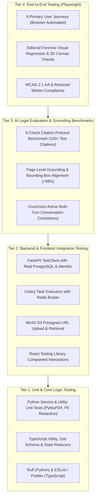

# NyaySahayak 2.0 — Comprehensive Quality Assurance & Test Strategy

**Document Reference**: `docs/TEST_STRATEGY.md`  
**Status**: Approved Testing Strategy  
**Testing Frameworks**: `pytest` (Backend), `Playwright` (End-to-End), `Vitest` / `@testing-library/react` (Frontend)  
**Quality Gates**: Ruff, ESLint, TypeScript Compiler (`tsc --noEmit`), GitHub Actions  
**Author**: Lead Software Architect & QA Lead  

---

## 1. Testing Philosophy & Verification Principles

In a legal intelligence and courtroom preparation platform, software bugs do not merely cause UI glitches—they risk professional sanction for practicing advocates, loss of evidentiary privilege, or misleading appellate courts.

NyaySahayak 2.0 establishes five non-negotiable testing mandates:
1. **Never Claim a Test Passed Without Executing It**:
   Every completion report must quote actual terminal execution commands and stdout/stderr results.
2. **Deterministic Evaluation of AI Outputs**:
   All AI-assisted features (fact extraction, citation verification, courtroom sparring) must be evaluated against deterministic ground-truth datasets with zero tolerance for unflagged hallucinations.
3. **Mock-Free Integration Testing**:
   Backend integration tests must execute against real PostgreSQL and Redis containers (via Docker or test database instances), validating actual SQL queries, constraints, and transactions.
4. **Strict Isolation of Synthetic Test Fixtures**:
   Synthetic cases and test judgments must be explicitly tagged `IS_SYNTHETIC = TRUE` to prevent test data from polluting authoritative legal corpora.
5. **Continuous Quality Gates**:
   No code is merged without passing formatting, strict type checking, unit tests, integration suites, and browser-driven end-to-end user journeys.

---

## 2. The 4-Tier Testing Pyramid



---

## 3. Tier 1: Unit Testing & Static Code Quality

### 3.1 Backend Unit Testing (`pytest`)
- **Scope**:
  - Pydantic v2 schema validation and serialization.
  - JWT token generation, expiration, and password hashing (Argon2id/bcrypt).
  - PII masking logic (Aadhaar 12-digit Verhoeff algorithm, PAN format regex).
  - PyMuPDF text and bounding-box coordinate extraction algorithms.
  - Mathematical calculations for citation matching scores.
- **Coverage Target**: > 90% branch coverage on core services (`services/` and `core/`).
- **Execution Command**:
  ```bash
  pytest backend/tests/unit -v --cov=app/services --cov=app/core --cov-report=term-missing
  ```

### 3.2 Static Linters & Type Checkers
- **Python**:
  ```bash
  ruff check backend/
  ruff format --check backend/
  ```
  Strict zero-warning policy on all backend code.
- **Frontend**:
  ```bash
  npm run lint
  npx tsc --noEmit
  ```
  TypeScript strict mode enabled (`noImplicitAny`, `strictNullChecks`, `noUncheckedIndexedAccess`).

---

## 4. Tier 2: Backend & Integration Testing

### 4.1 Database & Repository Integration
- Uses transactional rollback per test to ensure clean state:
  ```python
  @pytest.fixture(scope="function")
  def db_session():
      connection = engine.connect()
      transaction = connection.begin()
      session = TestingSessionLocal(bind=connection)
      yield session
      session.close()
      transaction.rollback()
      connection.close()
  ```
- Validates:
  - Foreign key cascading deletes (e.g. deleting a workspace deletes cases, documents, and chunks).
  - Row-Level Security (RLS) policies preventing cross-workspace data access.
  - `pgvector` similarity search operators (`<->` cosine distance queries).

### 4.2 Asynchronous Worker & Pipeline Testing
- Tests Celery tasks using `CELERY_TASK_ALWAYS_EAGER = True` for synchronous local execution or against an ephemeral Redis test instance.
- Validates:
  - Document upload confirmation -> text extraction -> page chunking -> embedding creation.
  - Graceful handling of corrupted PDF files and zero-byte uploads.

---

## 5. Tier 3: AI Legal Evaluation & Grounding Benchmarks

### 5.1 The Indian Citation Verification Benchmark (ICV-100)
A curated benchmark of 120 legal citations specifically designed to test the 6-Check Verification Engine across 5 test classes:

| Class | Count | Description | Expected Engine Decision |
| :--- | :---: | :--- | :--- |
| **A: Authentic & Active** | 40 | Landmark Supreme Court and High Court judgments cited accurately with verbatim quotes and correct holdings. | `VERIFIED` |
| **B: Misquoted Quotation** | 20 | Real cases where the quote has been subtly altered, paraphrased, or words like "not" removed. | `PARTIAL` (Quotation Fail) |
| **C: Distorted Proposition** | 20 | Real quotes, but applied to an unsustainable legal proposition (e.g. citing obiter dicta as binding ratio). | `PARTIAL` (Proposition Fail) |
| **D: Overruled Precedent** | 20 | Judgments that were good law when delivered, but subsequently overruled by a larger bench (e.g. *ADM Jabalpur*). | `OVERRULED` |
| **E: Complete Fabrication** | 20 | AI-hallucinated citations with plausible-sounding Indian party names, non-existent SCC volumes, or bogus Bare Act sections. | `FABRICATED` |

**Pass Criterion**: 100% of Class E (Fabricated) citations must be flagged. 0% may slip through as `VERIFIED`.

### 5.2 Page Provenance Grounding Accuracy
- Automated evaluation comparing extracted facts and timeline events against ground-truth human annotations of a 100-page appeal paper book.
- **Pass Criterion**: Every extracted entity must match the true page number and exhibit number with > 98% precision.

---

## 6. Tier 4: End-to-End Browser Testing (`Playwright`)

Playwright drives headless Chromium, Firefox, and WebKit to execute real end-to-end tests against the 9 Primary User Journeys:

### 6.1 Automated E2E Test Suite Matrix
1. `e2e/auth_workspace.spec.ts`: Registration -> Email confirmation -> Chamber workspace creation -> Member invite.
2. `e2e/case_docket.spec.ts`: Create new commercial case -> Metadata validation -> Status updates.
3. `e2e/document_upload.spec.ts`: Drag & drop PDF paper book -> Presigned S3 upload -> Progress bar -> Processing ready state.
4. `e2e/provenance_viewer.spec.ts`: Split-screen PDF viewer -> Click fact card -> Verify smooth scroll and exact bounding-box vermilion highlight ring.
5. `e2e/case_graph.spec.ts`: Trigger graph synthesis -> Inspect parties, timeline events, evidence admissibility badges, and legal issues.
6. `e2e/citation_audit.spec.ts`: Paste Class A and Class E citations -> Verify 6-check badges -> Submit lawyer review notes.
7. `e2e/courtroom_arena.spec.ts`: Select active issue -> Input oral argument -> Receive Opposing Counsel objection, Bench inquiry, and Courtroom Coach tactical rebuttal.
8. `e2e/case_rehydration.spec.ts`: Log out -> Log back in -> Reopen case docket -> Verify instant state restoration without re-running LLM pipelines.
9. `e2e/accessibility_3d.spec.ts`: Verify WCAG 2.1 AA keyboard navigation, high-contrast labels, and automatic 2D fallback when `prefers-reduced-motion` is enabled.

---

## 7. CI/CD Automation Pipeline (GitHub Actions)

```yaml
name: NyaySahayak 2.0 Quality Assurance

on:
  push:
    branches: [ main, develop ]
  pull_request:
    branches: [ main, develop ]

jobs:
  backend-qa:
    runs-on: ubuntu-latest
    services:
      postgres:
        image: pgvector/pgvector:pg16
        env:
          POSTGRES_DB: nyaysahayak_test
          POSTGRES_USER: test_user
          POSTGRES_PASSWORD: test_password
        ports:
          - 5432:5432
      redis:
        image: redis:7-alpine
        ports:
          - 6379:6379

    steps:
      - uses: actions/checkout@v4
      - name: Set up Python 3.12
        uses: actions/setup-python@v5
        with:
          python-version: '3.12'
      - name: Install dependencies
        run: |
          pip install --upgrade pip
          pip install ruff pytest pytest-cov
          pip install -r backend/requirements.txt
      - name: Ruff Lint & Format
        run: |
          ruff check backend/
          ruff format --check backend/
      - name: Run Alembic Migrations
        run: |
          cd backend && alembic upgrade head
      - name: Run Pytest Suite
        run: |
          pytest backend/tests -v --cov=app --cov-report=xml

  frontend-qa:
    runs-on: ubuntu-latest
    steps:
      - uses: actions/checkout@v4
      - name: Set up Node.js 20
        uses: actions/setup-node@v4
        with:
          node-version: '20'
          cache: 'npm'
          cache-dependency-path: frontend/package-lock.json
      - name: Install Dependencies
        run: cd frontend && npm ci
      - name: Type Check & Lint
        run: |
          cd frontend && npx tsc --noEmit
          cd frontend && npm run lint
      - name: Production Build Verification
        run: cd frontend && npm run build
      - name: Install Playwright Browsers
        run: cd frontend && npx playwright install --with-deps
      - name: Run Playwright E2E Suite
        run: cd frontend && npx playwright test
```
